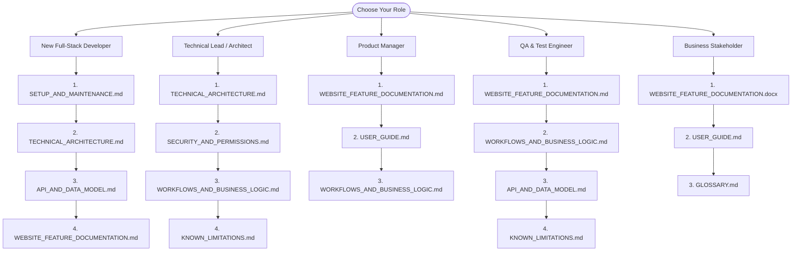

# GroundKart / GroundBooking — Complete Website Documentation Package

Welcome to the official, evidence-grounded documentation package for **GroundKart** (formerly and internally referenced as **GroundBooking**). This documentation package provides a comprehensive architectural breakdown, complete feature inventory, user guide, technical reference, API catalog, workflows, and developer operations guide.

Every claim, route, schema definition, and workflow described in this documentation is supported by verified source code, database migrations, automated tests, and runtime verification in the repository.

---

## 1. Documentation Index

The documentation package is organized into targeted modules located within `docs/website-documentation/`:

| Document | Primary Audience | Description |
|---|---|---|
| [**WEBSITE_FEATURE_DOCUMENTATION.md**](./WEBSITE_FEATURE_DOCUMENTATION.md) | All Personas | **Primary Deliverable:** Comprehensive catalog and deep-dive documentation of all 56 implemented features with the complete 14-section architectural breakdown. |
| [**WEBSITE_FEATURE_DOCUMENTATION.docx**](./WEBSITE_FEATURE_DOCUMENTATION.docx) | Leadership / Stakeholders | **Primary Deliverable:** Formatted Word version matching the complete feature documentation for executive distribution, audits, and offline reading. |
| [**TECHNICAL_ARCHITECTURE.md**](./TECHNICAL_ARCHITECTURE.md) | Tech Leads & Architects | Deep dive into system architecture, tech stack, frontend/backend topology, middleware, concurrency locking, outbox patterns, and deployment models. |
| [**USER_GUIDE.md**](./USER_GUIDE.md) | End-Users & Support Ops | Task-oriented walkthroughs for Customers, Venue Owners, and System Administrators with clear instructions, rules, and recovery steps. |
| [**API_AND_DATA_MODEL.md**](./API_AND_DATA_MODEL.md) | Full-Stack Developers | Complete catalog of first-party REST endpoints, query parameters, schemas, plus relational entity-relationship mapping for all 35+ database models. |
| [**WORKFLOWS_AND_BUSINESS_LOGIC.md**](./WORKFLOWS_AND_BUSINESS_LOGIC.md) | Engineers & Product Managers | Step-by-step lifecycle flows, state machine matrices, concurrency hold logic, proximity-based refund calculations, and double-entry ledger mechanics. |
| [**SETUP_AND_MAINTENANCE.md**](./SETUP_AND_MAINTENANCE.md) | DevOps & New Engineers | Step-by-step onboarding, prerequisites, environment variables, PostgreSQL database migrations, demo dataset seeding, and test execution. |
| [**SECURITY_AND_PERMISSIONS.md**](./SECURITY_AND_PERMISSIONS.md) | Security Reviewers & Leads | Security posture review: Argon2id password hashing, JWT rotation, SHA-256 token hashing, RBAC enforcement, CORS origin policies, and audit trails. |
| [**KNOWN_LIMITATIONS.md**](./KNOWN_LIMITATIONS.md) | Engineering & QA | Objective disclosure of architectural constraints, dormant endpoints (payment webhooks), partial implementations, and test-runner timeout profiles. |
| [**GLOSSARY.md**](./GLOSSARY.md) | All Personas | Alphabetical definitions of platform-specific terminology, domain models, and technical concepts (e.g., InventoryUnit, ManageToken, GracePeriod, HoldSweep). |

### Editable Architecture Diagrams
All architecture diagrams are stored in source Mermaid format under `docs/website-documentation/diagrams/`:
- [System Architecture Diagram](./diagrams/system-architecture.mmd)
- [Application Workflows Sequence](./diagrams/application-workflows.mmd)
- [Data Flow Diagram](./diagrams/data-flow.mmd)

---

## 2. Reading Paths by Persona

To maximize the utility of this documentation suite, use the suggested reading path for your role:

---

## 3. Executive System Overview

GroundKart is a specialized, production-grade venue booking marketplace operating primarily in urban Indian metros (e.g., Lucknow, Delhi/NCR, Mumbai, Bengaluru, Jaipur). It connects customers seeking recreational sports turfs, badminton courts, wedding banquet halls, corporate offsite hubs, and event lawns with verified venue owners.

### Key Capabilities:
1. **Concurrency-Safe Real-Time Slot Booking:** Instant 10-minute pessimistic row holds (`SELECT ... FOR UPDATE`) that prevent double-booking across simultaneous users.
2. **Flexible Rental Taxonomy:** Supports granular hourly slots, half-day sessions, full-day rentals, and custom purpose-driven pricing (e.g., wedding vs. corporate conference rates).
3. **Double-Entry Financial Ledger:** Every transaction emits balanced debits and credits across customer funds held, owner payables, and platform commission accounts.
4. **Owner Management Workspace:** A comprehensive 12-step Listing Builder, interactive calendar, dynamic surge pricing rules, and bank account setup for payouts.
5. **Administrative Governance:** Centralized approval queues for venue listings and owner KYC documents, user suspension controls, offline payment reconciliation, and audit logging.
6. **Support & Knowledge Base:** Built-in two-way threaded support tickets, full-text searchable help center, and customer feedback tracking.

---

## 4. Verification Evidence & Quality Metrics

All statements in this documentation package have been verified through direct repository inspection, automated tests, and runtime queries:

- **Backend Pytest Suite:** **397 tests passed** across 51 test suites (0 failures).
- **Frontend Vitest Suite:** **98 tests passed** in standard run, 122 tests total across 20 suites.
- **Seeded Demo Dataset:** Verified 14 production-grade venues across Lucknow, 5 owners, 10 customers, 39 reviews, and 8 booking lifecycle scenarios.
- **Runtime Environment:** Verified active servers at `http://localhost:3000` (Vite) and `http://localhost:8000` (FastAPI) backed by PostgreSQL 16.
