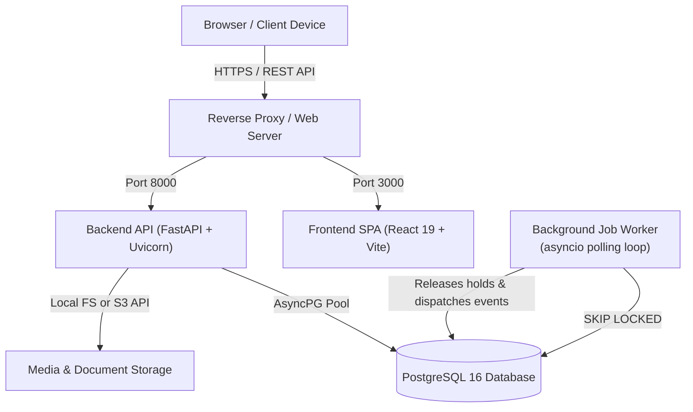
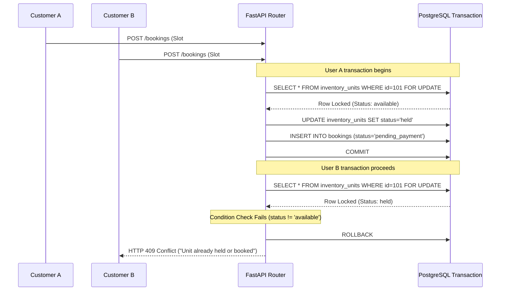
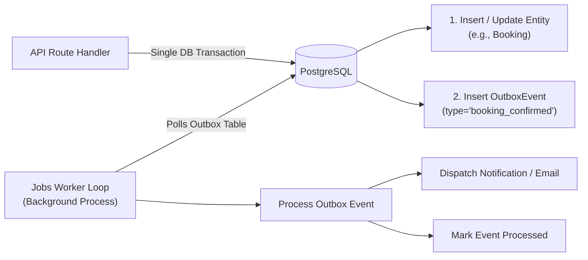

# GroundKart / GroundBooking — Technical Architecture Guide

This document provides a deep, evidence-based architectural examination of GroundKart (codebase package `groundbooking`). It details the system layers, communication protocols, concurrency controls, database design, background processing, and deployment architecture.

---

## 1. System Architecture Overview

GroundKart is implemented as a modern full-stack web application designed for high-concurrency venue discovery, reservation holding, financial ledgering, and administrative governance.



### Architectural Principles:
1. **Single Source of Truth:** Relational integrity enforced at the database schema level via foreign keys, check constraints, and unique indexes.
2. **Deterministic Financial Records:** Double-entry bookkeeping where every monetary movement creates balanced debits and credits.
3. **Pessimistic Concurrency Holds:** Row-level locks (`SELECT ... FOR UPDATE`) prevent double-booking across simultaneous checkout attempts.
4. **Decoupled Asynchronous Processing:** Heavy or delayed operations (e.g., hold sweeps, notification dispatch) execute via database-backed job queues with `SKIP LOCKED` mechanics.
5. **Role-Based Encapsulation:** Strict separation between Customer, Venue Owner, and Administrator permissions at the API route dependency layer.

---

## 2. Technology Stack & Exact Versions

The following table documents the actual runtime, build, and framework dependencies established from `backend/requirements.lock.txt` and `frontend/package.json`:

### Backend Technology Stack
| Layer / Component | Technology | Exact Version | Purpose & Evidence |
|---|---|---|---|
| **Runtime Language** | Python | `3.11.9+` | Modern asynchronous runtime supporting type annotations and `asyncio`. |
| **Web Framework** | FastAPI | `0.138.1` | High-performance asynchronous REST API framework with OpenAPI schema auto-generation. |
| **ASGI Server** | Uvicorn | `0.49.0` | Production ASGI web server running the FastAPI application. |
| **Database ORM** | SQLAlchemy | `2.0.51` | Asynchronous ORM utilizing the 2.0 style syntax with `selectinload` and `joinedload`. |
| **Database Driver** | asyncpg | `0.31.0` | High-performance PostgreSQL async driver for Python. |
| **Database Migrations** | Alembic | `1.18.5` | Relational schema versioning and migration execution tool. |
| **Data Validation** | Pydantic | `2.13.4` | Request payload parsing, model serialization, and type enforcement. |
| **Config Management** | Pydantic-Settings | `2.14.2` | Environment variable validation with production safety validators (`config.py`). |
| **Authentication** | PyJWT | `2.7.0` | JSON Web Token encoding and decoding for stateless API authorization. |
| **Password Hashing** | argon2-cffi | `25.1.0` | Cryptographically secure password hashing (Argon2id) resistant to GPU cracking. |
| **Cloud Storage** | aioboto3 | `13.2.0` | Asynchronous AWS S3 client for media and document storage. |
| **Test Runners** | pytest / pytest-asyncio | `9.1.1` / `1.4.0` | Test runner and async event-loop manager (397 passing tests across 51 suites). |
| **HTTP Client** | httpx | `0.28.1` | Asynchronous HTTP client for API integration tests. |

### Frontend Technology Stack
| Layer / Component | Technology | Exact Version | Purpose & Evidence |
|---|---|---|---|
| **Frontend Framework** | React | `19.0.1` | Latest React core library utilizing concurrent rendering and Suspense. |
| **Language** | TypeScript | `~5.8.2` | Strictly typed frontend code targeting ES2022. |
| **Build Tool / Bundler** | Vite | `6.2.3` | High-speed ESM bundler and HMR development server. |
| **Routing** | React Router DOM | `6.28.0` | Client-side routing, URL synchronization, and history navigation. |
| **Server State Cache** | TanStack React Query | `5.62.0` | Asynchronous server-state caching, optimistic updates, and background refetching. |
| **CSS & Design System** | Tailwind CSS | `4.1.14` | Utility-first styling engine with `@tailwindcss/vite` integration. |
| **Animations** | Framer Motion / GSAP | `12.43.0` / `3.15.0` | Smooth UI micro-interactions, modal transitions, and reveal effects. |
| **Smooth Scrolling** | Lenis | `1.3.26` | Momentum-based fluid scrolling experience. |
| **Iconography** | Lucide React | `0.546.0` | Comprehensive accessible SVG icon library. |
| **SEO & Head** | react-helmet-async | `3.0.0` | Dynamic `<head>` tag injection for meta descriptions and JSON-LD schemas. |
| **Unit Testing** | Vitest | `3.2.7` | Vite-native unit test runner executing DOM tests via JSDOM (122 tests). |
| **Testing Library** | @testing-library/react | `16.1.0` | Behavior-driven React component assertion utilities. |

---

## 3. Repository Structure & Directory Roles

The repository is organized as a unified monorepo:

```text
groundbooking/
├── .github/
│   └── workflows/
│       └── ci.yml               # GitHub Actions CI matrix (Postgres 16, backend pytest, frontend test/build)
├── backend/
│   ├── alembic/                 # Database migration scripts (47 revision files)
│   ├── app/
│   │   ├── models/              # SQLAlchemy model definitions (core.py: 35+ relational entities)
│   │   ├── modules/             # Modular service layers
│   │   │   ├── admin/           # Admin governance, health checks, password resets, review moderation
│   │   │   ├── analytics/       # GMV, occupancy, and platform performance aggregations
│   │   │   ├── auth/            # JWT issuance, Argon2id hashing, rate limiting, and dependencies
│   │   │   ├── booking/         # Booking engine, state machine, hold logic, and cancellations
│   │   │   ├── catalog/         # Venues, slots, amenities, categories, and content blocks
│   │   │   ├── core/            # Logging configuration, contextvars, and transactional outbox
│   │   │   ├── help/            # Help center categories, articles, feedback, and search logging
│   │   │   ├── homepage/        # Editorial placement configuration (featured & trending banners)
│   │   │   ├── jobs/            # Background worker loop and SKIP LOCKED job runner
│   │   │   ├── ledger/          # Double-entry ledger engine and financial reconciliation
│   │   │   ├── notifications/   # In-app notification delivery and read status tracking
│   │   │   ├── owner_dashboard/ # Owner revenue analytics, venue metrics, and booking feeds
│   │   │   ├── owner_onboarding/# KYC verification document handling and approval flows
│   │   │   ├── payments/        # Offline payment recording and legacy webhook handler
│   │   │   ├── payout/          # Payout calculation, disbursement batches, and bank accounts
│   │   │   ├── reviews/         # Star ratings, review submissions, and aggregate recalculation
│   │   │   ├── storage/         # Local file system and AWS S3 storage abstractions
│   │   │   └── support/         # Two-way support ticketing, event logging, and internal notes
│   │   ├── schemas/             # Pydantic v2 schemas for all request/response boundaries
│   │   ├── config.py            # Pydantic-based configuration and production safeguards
│   │   ├── db.py                # Async engine, connection pool, and SessionLocal generator
│   │   └── main.py              # FastAPI app factory, CORS, static mounts, and route registrations
│   ├── scripts/
│   │   └── seed_dataset.py      # Production-grade demo dataset seeder (14 venues, 10 users, reviews)
│   ├── tests/                   # Pytest test suite (397 passing tests across 51 test suites)
│   └── requirements.lock.txt    # Pinned production dependency lockfile
├── frontend/
│   ├── public/                  # Static assets (logos, WebP hero banners, favicon.svg)
│   ├── src/
│   │   ├── components/          # Reusable React components
│   │   │   ├── dashboard/       # Metric cards, status badges, admin drawer, passwords tab
│   │   │   ├── owner/           # Owner layout, workspace, calendar, and 12-step listing builder
│   │   │   ├── ui/              # GroundSelect, Toast notification container, BackToTopButton
│   │   │   ├── AdminLayout.tsx  # 12-tab administrative command center
│   │   │   ├── DetailView.tsx   # Comprehensive public venue detail page & slot picker
│   │   │   ├── Header.tsx       # Main navigation header with role switching & notifications
│   │   │   ├── Hero.tsx         # Search banner with city, date, and category filters
│   │   │   ├── MyBookings.tsx   # Customer reservations management dashboard
│   │   │   ├── ReviewPay.tsx    # Checkout and payment confirmation interface
│   │   │   └── SupportTickets.tsx # Contextual support ticket creation and conversation thread
│   │   ├── hooks/               # Custom React hooks (useVenues, useAdmin, useOwner, useBookings)
│   │   ├── lib/
│   │   │   ├── api/             # Typed API clients (admin, auth, bookings, owner, support, venues)
│   │   │   ├── auth.tsx         # Authentication React context provider & token manager
│   │   │   ├── schema.ts        # JSON-LD Schema.org structured data generators
│   │   │   └── site.ts          # Absolute URL helpers and platform constants
│   │   ├── App.tsx              # Root component, client-side routing, and role state management
│   │   └── types.ts             # Shared frontend domain interfaces
│   ├── package.json             # NPM dependencies and development scripts
│   └── vite.config.ts           # Vite bundler configuration with Tailwind integration
├── design-assets/               # High-resolution original source imagery
└── docs/                        # Complete project documentation suite
```

---

## 4. Application Entry Points & Lifecycles

### Backend Entry Point (`backend/app/main.py`)
1. **Lifespan Context Manager (`lifespan`)**:
   - Initializes on FastAPI startup.
   - Starts the asynchronous background worker (`asyncio.create_task(worker_loop())`) which polls the database for scheduled jobs (such as hold sweeps).
   - Gracefully cancels and awaits worker shutdown on application termination.
2. **Middleware Registration**:
   - `CorrelationIdMiddleware`: Extracts or assigns a UUID `X-Request-ID` to every inbound request, injecting it into `contextvars` for end-to-end log correlation.
   - `TimingMiddleware`: Records processing duration and appends `X-Process-Time-Ms` headers.
   - `RateLimiter`: Enforces IP and user-based limits on sensitive endpoints (`/api/v1/auth/login`, `/api/v1/auth/forgot-password`).
   - `CORSMiddleware`: Validates `Origin` against `cors_allowed_origins`, rejecting unauthorized cross-origin requests.
3. **Static File Serving**:
   - Mounts `/uploads` to serve uploaded venue imagery and KYC documents in local development mode.

### Frontend Entry Point (`frontend/src/main.tsx` & `App.tsx`)
1. **Initialization (`main.tsx`)**:
   - Mounts into `#root`.
   - Wraps application in `HelmetProvider` (for head metadata management) and `QueryClientProvider` (TanStack React Query).
   - Initializes `ToastProvider` for platform-wide alerts.
2. **Root Shell (`App.tsx`)**:
   - Inspects `window.location.pathname` and synchronizes browser history with the internal view state (`home`, `search`, `detail`, `checkout`, `my-bookings`, `support`, `about`, `contact`, `privacy`, `terms`, `404`).
   - Dynamically evaluates user authentication status via `useAuth()`. If an authenticated user holds the `owner` role, `OwnerLayout` is loaded; if `admin`, `AdminLayout` is loaded.

---

## 5. Concurrency Control & Booking Engine Design

Preventing double-booking is the core technical challenge of any venue reservation platform. GroundKart enforces concurrency safety using **pessimistic row-level locking**:



### The 10-Minute Hold Window & Sweep Mechanic
1. When a booking is initiated, the slot status transitions to `held`, and `expires_at` is set to `now() + 10 minutes`.
2. If payment is completed and confirmed, the slot transitions to `booked`.
3. If payment is not received within the hold duration, the row becomes eligible for release.
4. The background job worker runs `sweep_expired_holds`:
   - Finds all `inventory_units` where `status = 'held'` and `expires_at < now()`.
   - Updates slot status back to `available`.
   - Transitions corresponding booking records from `pending_payment` to `expired`.
   - Creates a `BookingEvent` audit entry documenting the automated expiration.

---

## 6. Financial Architecture & Double-Entry Ledger

All financial movements are recorded in an append-only, double-entry ledger (`ledger_entries` table) ensuring auditability and compliance:

### Chart of Accounts:
- `customer_funds_held` (Asset / Escrow): Funds collected from customers prior to event completion.
- `owner_payable` (Liability): Net funds owed to venue owners after deducting platform commission.
- `platform_commission_revenue` (Revenue): Platform take-rate earned upon booking completion.
- `platform_cash` (Asset): Liquid bank funds disbursed during owner payouts.

### Transaction Invariant:
For every transaction, `SUM(debits) == SUM(credits)`.

```text
Payment Confirmation (e.g., ₹10,000 Booking with 10% Commission):
  Debit:   customer_funds_held          ₹10,000.00
  Credit:  owner_payable                 ₹9,000.00
  Credit:  platform_commission_revenue   ₹1,000.00
  Balance: ₹10,000.00 Debits == ₹10,000.00 Credits

Payout Disbursement (e.g., ₹9,000 Paid to Owner):
  Debit:   owner_payable                 ₹9,000.00
  Credit:  platform_cash                 ₹9,000.00
  Balance: ₹9,000.00 Debits == ₹9,000.00 Credits
```

---

## 7. Storage Architecture

The platform supports two storage backends governed by `STORAGE_BACKEND` in `config.py`:

1. **Local File Storage (`LocalFileStorage`)**:
   - Default for local development and test environments.
   - Saves files to `/tmp/groundkart-uploads` (public media) and `/tmp/groundkart-private-uploads` (KYC identity documents).
   - Exposes public media through FastAPI's `StaticFiles` mount at `http://localhost:8000/uploads/...`.
2. **AWS S3 / S3-Compatible Storage (`S3Storage`)**:
   - Production cloud storage utilizing `aioboto3`.
   - Uses pre-signed URLs or public bucket CDN endpoints for high-throughput image delivery.
   - Stores sensitive KYC documents in a private bucket accessible only via authenticated admin API proxy endpoints (`GET /api/v1/admin/owner-verifications/{id}/document`).

---

## 8. Asynchronous Processing & Outbox Pattern

To ensure database updates and external side-effects (e.g., sending emails, SMS, push notifications) are atomically coupled, the backend implements the **Transactional Outbox Pattern**:



This guarantees that notifications and third-party dispatches never execute if the surrounding database transaction rolls back, preventing ghost notifications.
