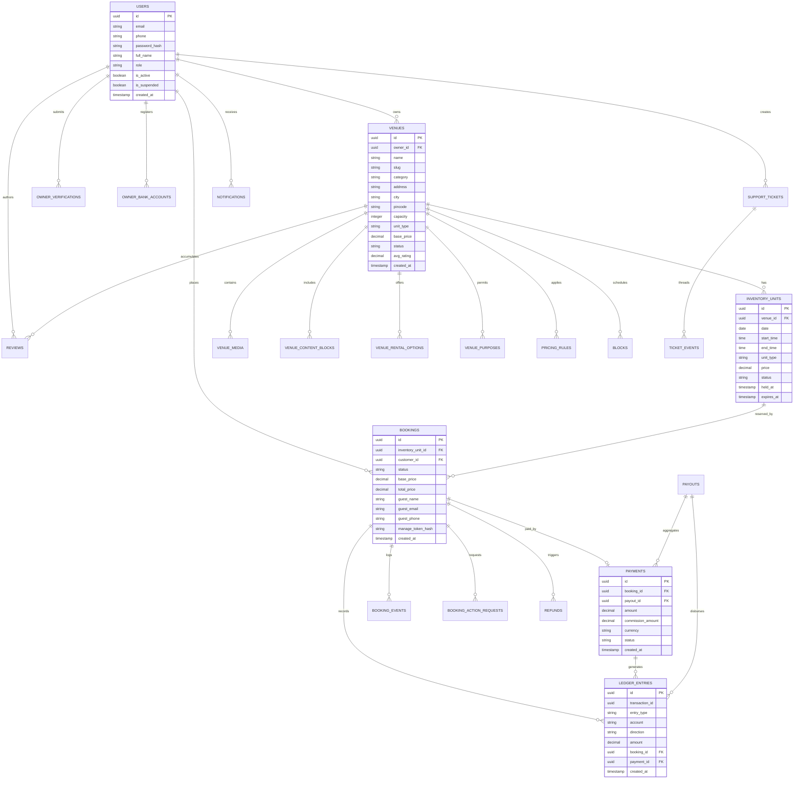

# GroundKart / GroundBooking — API Catalog & Data Model Reference

This reference document details every identifiable first-party REST API endpoint and the complete relational database schema across the application.

---

## 1. Entity-Relationship Data Model

The GroundKart persistence layer is managed via PostgreSQL 16 and SQLAlchemy 2.0. The following Mermaid ER diagram illustrates core domain entities and their relational foreign keys:

---

## 2. Relational Database Schema Catalog

### 2.1 Core Platform Tables
1. **`users`**:
   - `id` (UUID, Primary Key)
   - `email` (VARCHAR(255), Nullable, Indexed): Login identifier for customers/admins.
   - `phone` (VARCHAR(20), Nullable, Indexed): Mandatory identifier for mobile authentication in India.
   - `password_hash` (TEXT): Argon2id cryptographically hashed password.
   - `role` (VARCHAR(30)): Role string (`customer`, `owner`, `admin`).
   - `is_active` (BOOLEAN): Account activation status.
   - `is_suspended` (BOOLEAN): Administrative suspension flag.
   - `created_at` / `updated_at` (TIMESTAMPTZ): Audit timestamps.

2. **`venues`**:
   - `id` (UUID, Primary Key)
   - `owner_id` (UUID, Foreign Key → `users.id`): Property owner.
   - `name` (VARCHAR(255)): Official venue title.
   - `slug` (VARCHAR(255), Unique, Indexed): URL-safe kebab-case slug for SEO.
   - `category` (VARCHAR(50)): Primary classification (`sports`, `banquet_hall`, `corporate`, `farmhouse`).
   - `status` (VARCHAR(30)): Lifecycle state (`draft`, `pending_review`, `active`, `rejected`, `suspended`, `archived`).
   - `base_price` (NUMERIC(10, 2)): Standard base rental rate.
   - `capacity` (INTEGER): Maximum permitted attendees.
   - `rejection_reason` / `suspension_reason` (TEXT): Administrative audit notes.

3. **`inventory_units`**:
   - `id` (UUID, Primary Key)
   - `venue_id` (UUID, Foreign Key → `venues.id`): Associated venue.
   - `date` (DATE): Target calendar date.
   - `start_time` / `end_time` (TIME): Operating window for the slot.
   - `price` (NUMERIC(10, 2)): Standard or surge rate for this specific unit.
   - `status` (VARCHAR(30)): State (`available`, `held`, `booked`, `blocked`).
   - `held_at` (TIMESTAMPTZ): Timestamp when slot lock was created.
   - `expires_at` (TIMESTAMPTZ): Expiration timestamp for the 10-minute hold window.

4. **`bookings`**:
   - `id` (UUID, Primary Key)
   - `inventory_unit_id` (UUID, Foreign Key → `inventory_units.id`): Reserved slot.
   - `customer_id` (UUID, Foreign Key → `users.id`, Nullable): Registered user account, or null for guests.
   - `guest_name`, `guest_email`, `guest_phone` (TEXT): Guest contact details.
   - `manage_token_hash` (VARCHAR(64), Indexed): SHA-256 digest of guest access token.
   - `status` (VARCHAR(30)): State (`draft`, `pending_payment`, `confirmed`, `completed`, `cancelled`, `refunded`, `expired`, `disputed`).
   - `total_price` (NUMERIC(10, 2)): Total monetary amount payable.

### 2.2 Financial & Ledger Tables
5. **`ledger_entries`**:
   - `id` (UUID, Primary Key)
   - `transaction_id` (UUID, Indexed): Correlates all balanced debit/credit legs of a transaction.
   - `entry_type` (VARCHAR(50)): Event type (`booking_payment`, `refund`, `payout_disbursement`).
   - `account` (VARCHAR(50)): Chart account (`customer_funds_held`, `owner_payable`, `platform_commission_revenue`, `platform_cash`).
   - `direction` (VARCHAR(10)): `debit` or `credit`.
   - `amount` (NUMERIC(12, 2)): Transaction amount (strictly positive).
   - `booking_id` / `payment_id` / `payout_id` (UUID, Foreign Keys): Entity traceability.

6. **`payouts`**:
   - `id` (UUID, Primary Key)
   - `owner_id` (UUID, Foreign Key → `users.id`): Recipient owner.
   - `amount` (NUMERIC(10, 2)): Net disbursement amount.
   - `status` (VARCHAR(30)): State (`pending`, `processing`, `paid`, `failed`).
   - `paid_at` (TIMESTAMPTZ): Timestamp when admin marked funds disbursed.

7. **`refunds`**:
   - `id` (UUID, Primary Key)
   - `booking_id` (UUID, Foreign Key → `bookings.id`): Associated reservation.
   - `amount` (NUMERIC(10, 2)): Amount refunded to customer.
   - `refund_tier` (VARCHAR(30)): Proximity tier (`full_refund`, `partial_refund`, `no_refund`).
   - `status` (VARCHAR(30)): State (`pending`, `completed`, `failed`).

### 2.3 Operational & Audit Tables
8. **`support_tickets`**:
   - `id` (UUID, Primary Key)
   - `user_id` (UUID, Foreign Key → `users.id`): Ticket author.
   - `venue_id` / `booking_id` (UUID, Nullable Foreign Keys): Contextual entity links.
   - `subject` / `description` (TEXT): Ticket content.
   - `category` (VARCHAR(50)): Topic (`booking_issue`, `payment_dispute`, `facility_complaint`, `general`).
   - `priority` (VARCHAR(20)): `low`, `normal`, `high`, `urgent`.
   - `status` (VARCHAR(30)): Lifecycle state (`open`, `in_review`, `waiting_customer`, `resolved`, `closed`).

9. **`audit_logs`**:
   - `id` (UUID, Primary Key)
   - `actor_id` (UUID, Nullable): User or admin who performed the action.
   - `action` (VARCHAR(100)): Action code (e.g., `venue.approved`, `booking.payment_confirmed`).
   - `target_type` / `target_id` (VARCHAR / UUID): Entity acted upon.
   - `details` (JSONB): Structured contextual snapshot.
   - `created_at` (TIMESTAMPTZ): Immutable event timestamp.

10. **`jobs` & `outbox_events`**:
    - Manages asynchronous task scheduling and outbox notification delivery using PostgreSQL `FOR UPDATE SKIP LOCKED`.

---

## 3. First-Party REST API Catalog

The backend exposes a structured, versioned REST API at `/api/v1`.

### 3.1 Authentication & Profile Module (`/api/v1/auth`, `/api/v1/users`)
| Method | Path | Purpose | Required Role | Request Body | Response Model |
|---|---|---|---|---|---|
| `POST` | `/api/v1/auth/signup` | Register new customer or owner | Public | `SignupRequest` (`email`, `phone`, `password`, `full_name`, `role`) | `UserMeResponse` (HTTP 201) |
| `POST` | `/api/v1/auth/login` | Authenticate with credentials | Public | `LoginRequest` (`email_or_phone`, `password`) | `AccessTokenResponse` (`access_token`, `refresh_token`, `token_type`) |
| `POST` | `/api/v1/auth/refresh` | Refresh expired access token | Public | `RefreshTokenRequest` (`refresh_token`) | `AccessTokenResponse` |
| `POST` | `/api/v1/auth/logout` | Invalidate active refresh token | Authenticated | None | HTTP 204 No Content |
| `POST` | `/api/v1/auth/forgot-password` | Request password reset token | Public | `ForgotPasswordRequest` (`email`) | HTTP 200 JSON message |
| `POST` | `/api/v1/auth/reset-password` | Set new password via token | Public | `ResetPasswordRequest` (`token`, `new_password`) | HTTP 200 JSON message |
| `GET` | `/api/v1/users/me` | Fetch authenticated user profile | Authenticated | None | `UserMeResponse` |
| `DELETE` | `/api/v1/users/me` | Account deletion / Right to Erasure | Authenticated | None | HTTP 204 No Content |

### 3.2 Catalog & Public Discovery Module (`/api/v1/venues`, `/api/v1/categories`)
| Method | Path | Purpose | Required Role | Query Parameters | Response Model |
|---|---|---|---|---|---|
| `GET` | `/api/v1/categories` | List venue categories | Public | None | `list[CategoryResponse]` |
| `GET` | `/api/v1/venue-types` | List space taxonomy types | Public | None | `list[VenueTypeResponse]` |
| `GET` | `/api/v1/use-cases` | List event purposes | Public | None | `list[UseCaseResponse]` |
| `GET` | `/api/v1/venues` | Discover & search venues | Public | `city`, `category`, `available_on`, `limit`, `offset` | `VenueListResponse` (`data`, `total`, `limit`, `offset`) |
| `GET` | `/api/v1/venues/{id}` | Get venue specifications & media | Public | None | `VenueResponse` |
| `GET` | `/api/v1/venues/{id}/availability` | Real-time slots & dates matrix | Public | `date_from`, `date_to` | `list[DateAvailabilityResponse]` |
| `GET` | `/api/v1/venues/{id}/reviews` | List approved venue reviews | Public | None | `list[ReviewResponse]` |
| `POST` | `/api/v1/venues/{id}/reviews` | Post new review | Authenticated | `ReviewCreateRequest` (`rating`, `comment`) | `ReviewResponse` (HTTP 201) |
| `GET` | `/api/v1/homepage` | Get editorial featured & trending placements | Public | None | `HomepageResponse` |

### 3.3 Booking & Reservation Module (`/api/v1/bookings`)
| Method | Path | Purpose | Required Role | Request Body | Response Model |
|---|---|---|---|---|---|
| `POST` | `/api/v1/bookings` | Initiate reservation & 10m hold | Public / Auth | `BookingCreateRequest` (`inventory_unit_id`, `guest_name`, `guest_email`, `guest_phone`, `purpose_id`, `rental_mode`, `guest_count`, `customer_notes`) | `BookingCreateResponse` (`id`, `status`, `expires_in`, `manage_url`) (HTTP 201) |
| `GET` | `/api/v1/bookings` | List authenticated user bookings | Customer | None | `list[BookingDetail]` |
| `GET` | `/api/v1/bookings/{id}` | Get specific booking details | Customer / Admin | None | `BookingDetail` |
| `GET` | `/api/v1/bookings/manage/{token}` | Access guest booking by secure token | Public | None | `BookingDetail` |
| `POST` | `/api/v1/bookings/{id}/cancel` | Cancel booking & trigger refund | Customer / Admin | `BookingCancelRequest` | `BookingCancelResponse` (`refund_tier`, `refund_amount`) |
| `POST` | `/api/v1/bookings/manage/{token}/cancel` | Cancel guest booking via token | Public | `BookingCancelRequest` | `BookingCancelResponse` |
| `POST` | `/api/v1/bookings/{id}/flag` | Flag booking dispute | Customer / Owner | `BookingFlagRequest` (`reason`) | HTTP 200 JSON message |

### 3.4 Venue Owner Workspace Module (`/api/v1/owner`)
| Method | Path | Purpose | Required Role | Request Body | Response Model |
|---|---|---|---|---|---|
| `POST` | `/api/v1/owner/verification` | Submit KYC identity verification | Authenticated | Form-data (`business_name`, `identification_type`, `identification_number`, `document` file) | `OwnerVerificationResponse` (HTTP 201) |
| `GET` | `/api/v1/owner/verification` | Get current owner KYC status | Authenticated | None | `OwnerVerificationResponse \| None` |
| `GET` | `/api/v1/owner/venues` | List properties owned by user | Owner | None | `list[VenueResponse]` |
| `POST` | `/api/v1/venues` | Create initial venue draft | Owner | `VenueCreateRequest` | `VenueResponse` (HTTP 201) |
| `PATCH` | `/api/v1/venues/{id}` | Update venue fields (autosave) | Owner / Admin | `VenueUpdateRequest` | `VenueResponse` |
| `POST` | `/api/v1/venues/{id}/images` | Upload venue photo / video | Owner / Admin | Multipart File upload (`file`, `is_cover`) | `VenueResponse` (HTTP 201) |
| `POST` | `/api/v1/owner/venues/{id}/media/link` | Add media by external URL | Owner | `MediaLinkCreateRequest` | `VenueMediaResponse` (HTTP 201) |
| `PUT` | `/api/v1/owner/venues/{id}/media/reorder` | Reorder gallery media order | Owner | `MediaReorderRequest` | `list[VenueMediaResponse]` |
| `POST` | `/api/v1/venues/{id}/blocks` | Block slots for maintenance | Owner | `BlockCreateRequest` (`start_time`, `end_time`, `reason`) | `BlockResponse` (HTTP 201) |
| `GET` | `/api/v1/owner/overview` | Get revenue analytics & metrics | Owner | None | `OwnerOverviewResponse` |
| `GET` | `/api/v1/owner/payouts` | List owner payouts & history | Owner | None | `list[PayoutDetail]` |
| `POST` | `/api/v1/owner/bank-accounts` | Register bank account for payouts | Owner | `OwnerBankAccountCreateRequest` | `OwnerBankAccountResponse` (HTTP 201) |

### 3.5 Administrative Command Center Module (`/api/v1/admin`)
| Method | Path | Purpose | Required Role | Request / Parameters | Response Model |
|---|---|---|---|---|---|
| `GET` | `/api/v1/admin/dashboard/overview` | Platform-wide KPIs & system health | Admin | None | `DashboardOverview` |
| `GET` | `/api/v1/admin/venues` | List all platform venues | Admin | `status`, `limit`, `offset` | `list[AdminVenueView]` |
| `POST` | `/api/v1/admin/venues/{id}/approve` | Approve venue for public launch | Admin | None | `VenueResponse` |
| `POST` | `/api/v1/admin/venues/{id}/reject` | Reject venue with reason | Admin | `VenueRejectRequest` (`reason`) | `VenueResponse` |
| `POST` | `/api/v1/admin/venues/{id}/suspend` | Suspend active venue | Admin | `SuspendRequest` (`reason`) | `VenueResponse` |
| `POST` | `/api/v1/admin/venues/{id}/reactivate` | Reactivate suspended venue | Admin | None | `VenueResponse` |
| `GET` | `/api/v1/admin/owner-verifications` | List pending owner KYC reviews | Admin | None | `list[AdminOwnerVerificationView]` |
| `POST` | `/api/v1/admin/owner-verifications/{id}/approve` | Approve owner KYC verification | Admin | None | `OwnerVerificationResponse` |
| `POST` | `/api/v1/admin/owner-verifications/{id}/reject` | Reject owner KYC verification | Admin | `RejectVerificationRequest` (`reason`) | `OwnerVerificationResponse` |
| `POST` | `/api/v1/admin/bookings/{id}/confirm-payment` | Confirm offline payment & book slot | Admin | `AdminConfirmPaymentRequest` | `BookingDetail` |
| `POST` | `/api/v1/admin/bookings/{id}/cancel-pending` | Cancel unconfirmed pending hold | Admin | `AdminCancelPendingBookingRequest` | `BookingDetail` |
| `POST` | `/api/v1/admin/bookings/sweep-expired-holds` | Manually sweep expired 10m holds | Admin | None | HTTP 200 (`swept_count`) |
| `GET` | `/api/v1/admin/ledger/reconcile` | Verify double-entry ledger balance | Admin | None | `ReconciliationResponse` (`is_balanced`, `total_debits`, `total_credits`) |
| `POST` | `/api/v1/admin/payouts/run` | Generate batch owner payouts | Admin | `PayoutRunRequest` | `PayoutDetail` |
| `POST` | `/api/v1/admin/payouts/{id}/mark-paid` | Confirm bank disbursement completed | Admin | `PayoutMarkPaidRequest` | `PayoutDetail` |
| `DELETE` | `/api/v1/admin/reviews/{id}` | Delete inappropriate review | Admin | None | HTTP 204 No Content |
| `GET` | `/api/v1/admin/health` | Deep diagnostic system telemetry | Admin | None | `AdminHealthResponse` |

### 3.6 Customer Support & Help Center Module (`/api/v1/support`, `/api/v1/help`, `/api/v1/contact`)
| Method | Path | Purpose | Required Role | Request / Parameters | Response Model |
|---|---|---|---|---|---|
| `GET` | `/api/v1/support/tickets` | List user support tickets | Customer / Owner | `status`, `limit`, `offset` | `list[SupportTicketDetail]` |
| `POST` | `/api/v1/support/tickets` | Open new support ticket | Authenticated | `TicketCreateRequest` (`subject`, `description`, `category`, `priority`, `venue_id`, `booking_id`) | `SupportTicketDetail` (HTTP 201) |
| `GET` | `/api/v1/support/tickets/{id}` | Get ticket thread & history | Participant / Admin | None | `SupportTicketDetail` |
| `POST` | `/api/v1/support/tickets/{id}/comments` | Reply to ticket thread | Participant / Admin | `TicketCommentRequest` (`message`, `is_internal`) | `TicketEventResponse` (HTTP 201) |
| `GET` | `/api/v1/help/categories` | List help center categories | Public | None | `list[HelpCategoryResponse]` |
| `GET` | `/api/v1/help/articles` | Search & browse help articles | Public | `query`, `category_id`, `limit`, `offset` | `HelpArticleListResponse` |
| `GET` | `/api/v1/help/articles/{slug}` | Read specific help article | Public | None | `HelpArticleDetailResponse` |
| `POST` | `/api/v1/help/articles/{id}/feedback` | Submit helpful/unhelpful rating | Public | `HelpFeedbackRequest` (`is_helpful`, `feedback_text`) | HTTP 200 JSON message |
| `POST` | `/api/v1/contact` | Submit public contact inquiry | Public | `ContactSubmitRequest` (`name`, `email`, `phone`, `subject`, `message`) | `ContactSubmitResponse` (HTTP 200) |

### 3.7 Notification Delivery Module (`/api/v1/notifications`)
| Method | Path | Purpose | Required Role | Request / Parameters | Response Model |
|---|---|---|---|---|---|
| `GET` | `/api/v1/notifications` | Fetch user notification feed | Authenticated | `unread_only`, `limit`, `offset` | `list[NotificationResponse]` |
| `GET` | `/api/v1/notifications/unread-count`| Get unread badge counter | Authenticated | None | `UnreadCountResponse` (`unread_count`) |
| `POST` | `/api/v1/notifications/{id}/read` | Mark notification as read | Authenticated | None | HTTP 200 JSON message |
| `POST` | `/api/v1/notifications/read-all` | Mark all notifications read | Authenticated | None | HTTP 200 JSON message |
| `DELETE` | `/api/v1/notifications/{id}` | Dismiss single notification | Authenticated | None | HTTP 204 No Content |
| `DELETE` | `/api/v1/notifications` | Clear all user notifications | Authenticated | None | HTTP 204 No Content |

### 3.8 System Health Diagnostics & SEO Endpoints
| Method | Path | Purpose | Required Role | Request / Parameters | Response Model |
|---|---|---|---|---|---|
| `GET` | `/healthz` | Kubernetes / container liveness probe | Public | None | HTTP 200 `{"status": "ok"}` |
| `GET` | `/api/v1/health` | Service dependency health check | Public | None | HTTP 200 `{"status": "healthy", "database": "connected"}` |
| `GET` | `/robots.txt` | Search crawler indexing instructions | Public | None | Text `robots.txt` |
| `GET` | `/sitemap.xml` | XML sitemap for search engines | Public | None | XML sitemap |

