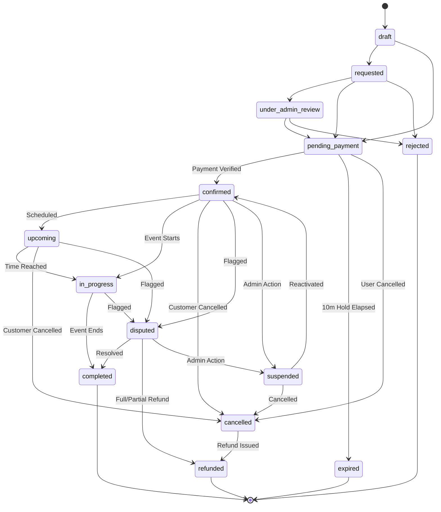
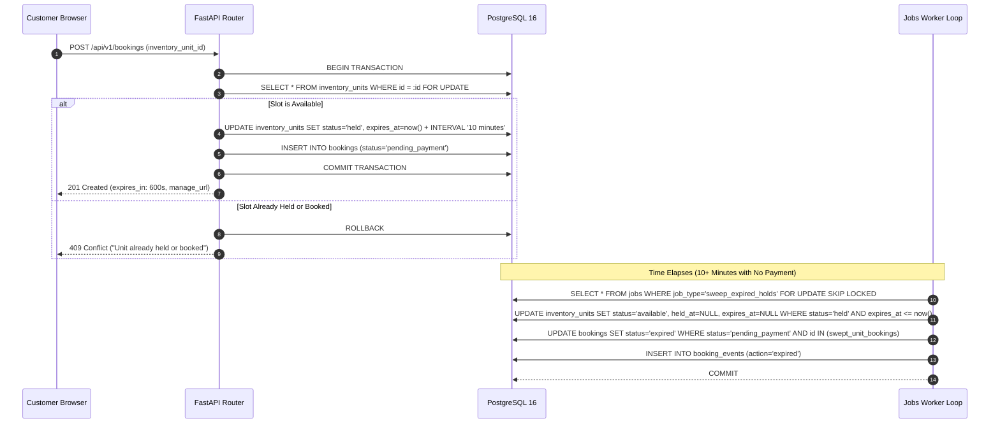
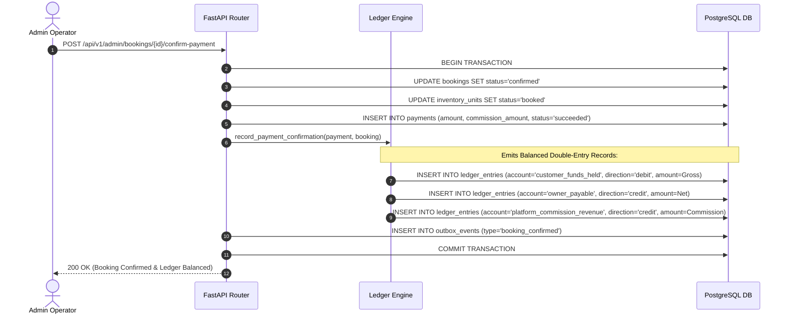
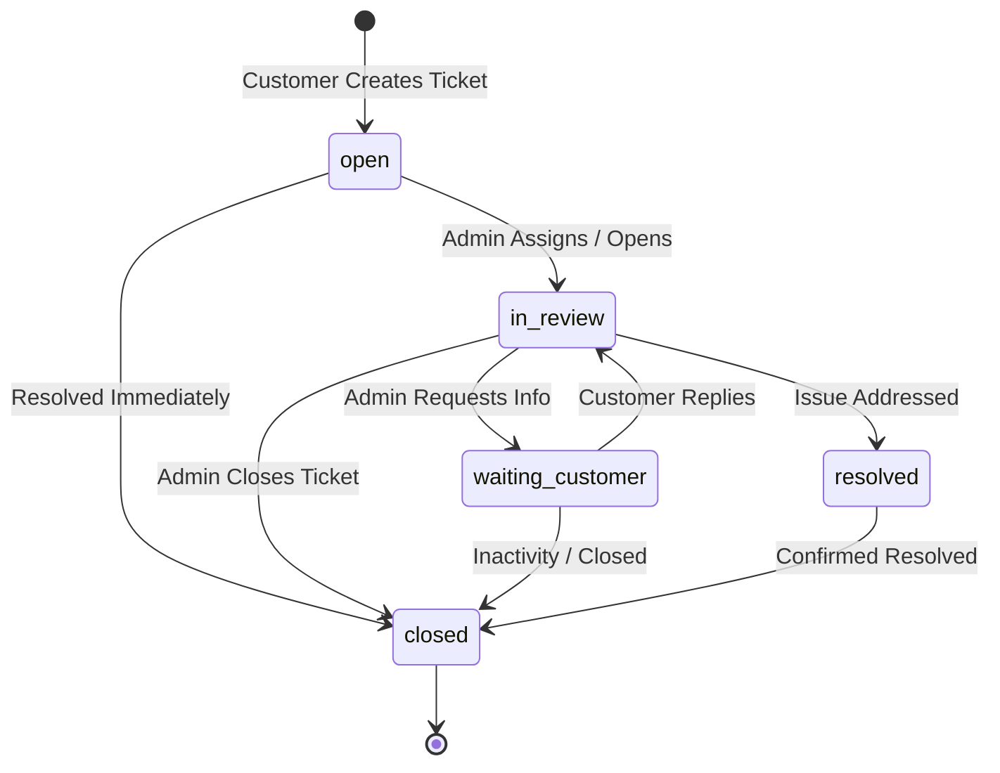

# GroundKart / GroundBooking — Workflows & Business Logic

This document details the business logic, state machine rules, and step-by-step lifecycle workflows that govern GroundKart.

---

## 1. Booking Lifecycle State Machine

The platform enforces a strict, centralized finite state machine (`transition_booking_status` in `backend/app/modules/booking/domain.py`). Any attempt to transition between invalid states raises an `HTTP 409 Conflict`.

### Complete State Transition Table
| Starting State | Permitted Destination States | Triggering Event / Actor |
|---|---|---|
| `draft` | `requested`, `pending_payment` | Customer submits initial slot request. |
| `requested` | `under_admin_review`, `pending_payment`, `rejected` | System or admin evaluates required approvals. |
| `under_admin_review` | `pending_payment`, `rejected` | Platform administrator evaluates manual inquiry. |
| `pending_payment` | `confirmed`, `expired`, `cancelled` | Admin confirms offline payment, hold expires (10m), or user cancels. |
| `confirmed` | `upcoming`, `in_progress`, `cancelled`, `disputed`, `suspended` | Automated cron/time progression, customer cancellation, or dispute. |
| `upcoming` | `in_progress`, `cancelled`, `disputed` | Slot start time arrives, customer cancels, or dispute flagged. |
| `in_progress` | `completed`, `disputed` | Event duration completes or dispute flagged during event. |
| `disputed` | `completed`, `refunded`, `suspended` | Administrator reviews dispute notes and reaches resolution. |
| `suspended` | `confirmed`, `cancelled` | Administrative compliance hold cleared or booking terminated. |
| `cancelled` | `refunded` | Financial refund is recorded and disbursed. |
| `completed` | *Terminal State* | Booking fulfilled; review submission becomes available. |
| `expired` | *Terminal State* | Hold window elapsed without payment confirmation; slot released. |
| `refunded` | *Terminal State* | Booking cancelled and funds returned per refund policy. |
| `rejected` | *Terminal State* | Booking declined by owner or administrator. |

---

## 2. Concurrency Holds & Hold Sweep Worker

To prevent double-booking without requiring instantaneous online card processing, GroundKart pairs pessimistic database locking with an automated sweeping worker:

---

## 3. Cancellation & Proximity-Based Refund Policy

Customer-initiated cancellations automatically determine the applicable refund percentage based on how far in advance the cancellation is requested relative to the slot's scheduled start time:

### Refund Policy Matrix:
| Proximity to Event Start Time | Applicable Refund Tier | Customer Refund Percentage | Platform / Owner Retained |
|---|---|---|---|
| **48 Hours or More** (`>= 48h`) | `full_refund` | **100%** | **0%** |
| **24 Hours to 48 Hours** (`>= 24h` and `< 48h`) | `partial_refund` | **50%** | **50%** (Cancellation fee) |
| **Less than 24 Hours** (`< 24h`) | `no_refund` | **0%** | **100%** (Full forfeiture) |

### Atomic Cancellation Transaction:
When `POST /api/v1/bookings/{id}/cancel` executes:
1. Calculates hours remaining between `now(IST)` and `slot.date + slot.start_time(IST)`.
2. Computes refund fraction (1.0, 0.5, or 0.0) and calculates `refund_amount = total_price * fraction`.
3. Updates `bookings.status` to `cancelled` and marks `inventory_units.status` back to `available`.
4. Inserts a record in `refunds` detailing `refund_tier`, `amount`, and `status='completed'`.
5. Emits balanced entries in `ledger_entries` reversing the escrow liability.

---

## 4. Formal Booking Action Requests

For cancellations or reschedules that fall outside automated cutoffs or require manual administrative review (e.g., medical emergencies, weather disruptions), users submit a `BookingActionRequest`:

1. **Request Submission:** Customer or owner submits `POST /api/v1/bookings/{id}/cancellation-requests` or `/reschedule-requests`.
2. **Pending Queue:** The request enters the administrative queue (`GET /api/v1/admin/booking-actions`) with status `pending`.
3. **Audit Log:** An immutable `BookingEvent` is created documenting the request context.
4. **Administrative Decision:** An administrator reviews the request:
   - **Approve:** Executes the requested status change, adjusts slots, and issues the determined refund amount.
   - **Reject:** Leaves the booking in its current status and records the administrative rationale.

---

## 5. Offline Payment Reconciliation & Double-Entry Ledger Mechanics

GroundKart utilizes an offline payment confirmation model. Customers execute direct bank transfers or UPI payments, and administrators verify funds before confirming reservations.

### Step-by-Step Ledger Flow:

---

## 6. Support Ticket Lifecycle & Threading

Customer inquiries, payment disputes, and venue complaints follow an auditable state machine with role-based internal visibility:

### Privacy & Visibility Invariant:
- `is_internal` comments and notes posted by administrators are **never** returned to customers or owners in API responses (`GET /api/v1/support/tickets/{id}`).
- Sensitive events (priority changes, status updates, staff reassignment) create immutable entries in `ticket_events` and produce platform `AuditLog` records.
